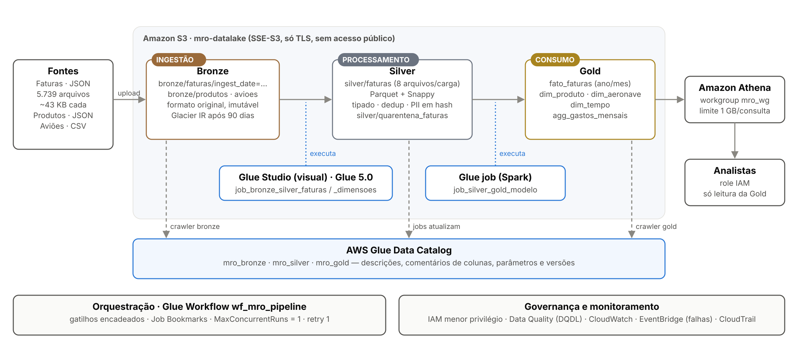
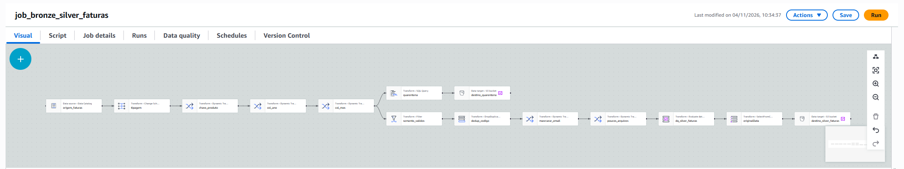
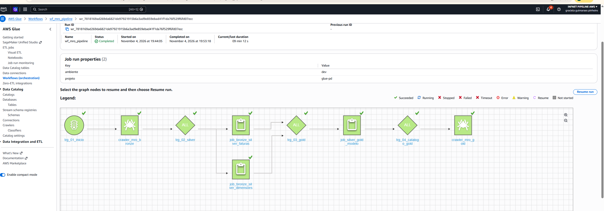

# Pipeline ETL com AWS Glue Studio

Projeto da disciplina **Pipelines ETL com AWS Glue Studio**, da Pós-Graduação em Engenharia de Dados (INFNET).

Pipeline de dados na AWS que leva arquivos brutos até um modelo analítico consultado pelo Amazon Athena, com transformações no **AWS Glue Studio** e metadados governados no **Glue Data Catalog**. Foi meu primeiro projeto prático com o Glue, e este repositório registra o resultado e o que aprendi pelo caminho.

**Aluna:** [seu nome] · **Região AWS:** us-east-2 (Ohio) · **Glue:** 5.0

## O que o pipeline faz

Um centro de manutenção de aeronaves (MRO) registra cada compra de ferramenta como uma fatura ligada à aeronave atendida. A partir dos três arquivos da disciplina, gerei **1.208.246 faturas em 5.739 arquivos JSON** e as processei em três camadas no S3:

| Camada | Conteúdo | Formato |
|---|---|---|
| **Bronze** | dados como chegaram, particionados pela data de chegada | JSON e CSV |
| **Silver** | dados limpos, tipados, sem duplicados, e-mail em hash; inválidos na quarentena | Parquet + Snappy |
| **Gold** | esquema estrela (1 fato, 3 dimensões) e agregado mensal | Parquet particionado por ano e mês |



## Resultados

| Indicador | Resultado |
|---|---|
| Faturas na Gold | 1.198.606 |
| Arquivos Bronze → Silver (lote 1) | 4.272 JSON → 8 Parquet |
| Volume Bronze → Silver (lote 1) | 164 MB → 21,5 MB |
| Processamento incremental (Job Bookmark) | lote 1 em 7 min 55 s; lote 2 em 3 min 42 s |
| Data Quality | 9 de 10 regras (a reprovada aponta 2.383 faturas com aeronave inexistente) |
| Quarentena | 4.799 preços nulos e 2.340 preços negativos |
| Pipeline completo (workflow) | 9 min 12 s |
| Custo real | US$ 4,61 no mês (maior parte em sessões de pré-visualização do editor) |

## Jobs e orquestração

- `job_bronze_silver_faturas`: job visual com 14 nós (tipagem, colunas derivadas, quarentena, filtro, deduplicação, hash do e-mail, Data Quality, gravação em Parquet).
- `job_bronze_silver_dimensoes`: job visual com dois ramos (produtos e aviões).
- `job_silver_gold_modelo`: job Spark que monta o esquema estrela.
- `wf_mro_pipeline`: crawler Bronze → 2 jobs Silver em paralelo → job Gold → crawler Gold.

| Job visual de faturas | Workflow concluído |
|---|---|
|  |  |

## Governança

- Role do Glue com **menor privilégio** (lê a Bronze, grava só na Silver e na Gold).
- Role de **analista** com acesso somente à Gold pelo Athena.
- Criptografia SSE-S3, bucket sem acesso público e só com TLS.
- Descrição, comentário de cada coluna e parâmetros de governança em todas as tabelas do Catalog.
- E-mail do responsável substituído por hash SHA-256 (LGPD).

## O que aprendi com os erros

| Problema | O que aprendi |
|---|---|
| Política da organização (SCP) bloqueou a criação de grupo IAM | Políticas da organização valem acima das permissões da conta |
| Sessões de pré-visualização do editor geraram a maior parte do custo | Recursos interativos cobram enquanto estão abertos |
| Nó Detect Sensitive Data converteu todas as colunas em texto | Conferir o schema gravado depois de cada transformação |
| Crawler classificou um JSON como CSV | Classificadores customizados precisam de conferência |
| Job Bookmark processou 1.000 dos 1.467 arquivos novos | O bookmark tem limite de arquivos recentes por execução |
| Job Gold sem permissão para gravar `gold_$folder$` | O menor privilégio revela detalhes do Spark |

## Estrutura do repositório

```
infra/       CloudFormation (fundação e orquestração) e script implantar.sh
jobs/        scripts equivalentes aos jobs visuais e o job Gold
governanca/  regras de Data Quality, script de metadados e consultas do Athena
dados/       arquivos da disciplina e o gerador do conjunto ampliado
testes/      validação local da lógica e números de referência
imagens/     55 capturas de tela da execução
docs/        relatório (Word), arquitetura e lista de evidências
```

## Como reproduzir

No AWS CloudShell, na região us-east-2:

```bash
python3 dados/gerar_dados.py
./infra/implantar.sh fundacao
./infra/implantar.sh lote1
./infra/implantar.sh metadados
# montar os jobs visuais no Glue Studio (ou: ./infra/implantar.sh orquestracao false)
./infra/implantar.sh orquestracao
./infra/implantar.sh lote2
./infra/implantar.sh limpar   # apaga tudo no final
```

## Documentos

- [Relatório do trabalho (Word)](docs/relatorio.docx)
- [Lista completa de evidências](docs/evidencias.md)
